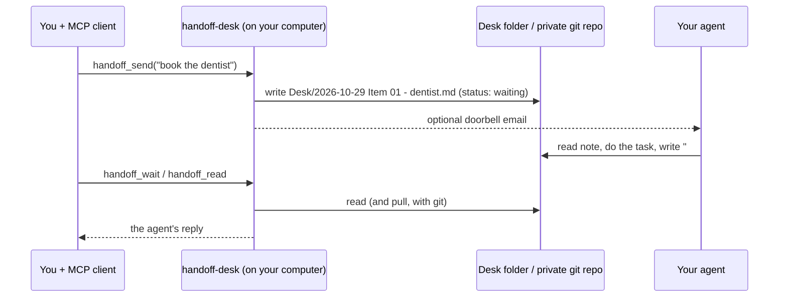

# handoff-desk

**Hand tasks from your coding session to a personal agent, and read the answer back.**

[](../../actions/workflows/ci.yml)
[](../../actions/workflows/security.yml)
[](LICENSE)
[](package.json)

`handoff-desk` is a small [MCP](https://modelcontextprotocol.io) server that runs on your computer. When you tell Claude Code, Cursor, Codex or another MCP client to "hand this to my agent", it writes a markdown note into a folder you own, optionally emails the agent a heads-up, and later reads the agent's reply from the same note.

- **No hosted service, no account, no telemetry.** Everything is files on your disk.
- **Works with any agent that can read a folder, a private git repository or a mailbox.** The format is plain markdown.
- **Safe by default.** Requests that look like they contain a password or key are refused, git transports are restricted, and text from the agent is marked as untrusted.
- **Reviewable.** Every task and answer is a note you can read, diff and delete.

> Status: 1.0. The tools and the note format are stable. Agent coverage is narrow: it is tested on every change with the bundled stand-in agent, and was tried with one real cloud agent over git and email (five rounds on 2026-10-26, all passed). Other agents are untested. See [Compatibility](#compatibility).

## How it works



More detail, including the folder layout and the git flow, is in [docs/architecture.md](docs/architecture.md).

## Quick start (5 minutes, no real agent needed)

You need [Node.js](https://nodejs.org) 22 or newer (this includes npm) and git. [pnpm](https://pnpm.io) works too.

**1. Install and build** (macOS, Linux and Windows):

```sh
git clone https://github.com/handoffdesk/handoff-desk.git
cd handoff-desk
npm install
npm run build
```

With pnpm: `pnpm install && pnpm build`.

**2. Create a demo desk.** `init` creates `Desk/`, `Inbox/`, `mail/` and a `handoff.md` template. Running it again never overwrites your edits.

```sh
node dist/main.js init ~/handoff-demo
```

**3. Add the server to Claude Code** (other clients: [docs/clients.md](docs/clients.md)). Use the absolute path to `dist/main.js` (on Windows with forward slashes, for example `C:/Users/you/handoff-desk/dist/main.js`):

```sh
claude mcp add handoff-demo -e HANDOFF_DIR="$HOME/handoff-demo" -- node /absolute/path/to/handoff-desk/dist/main.js
```

In **Windows PowerShell 5.1**, write the double dash in quotes. PowerShell drops a bare `--`, and `claude` then reports `missing required argument 'commandOrUrl'`:

```powershell
claude mcp add handoff-demo -e HANDOFF_DIR="$HOME/handoff-demo" '--' node C:/absolute/path/to/handoff-desk/dist/main.js
```

**4. Start the stand-in agent** in a second terminal and leave it running. It answers every waiting item with a fixed line. In macOS or Linux shells:

```sh
cd handoff-desk
HANDOFF_DIR="$HOME/handoff-demo" node dist/main.js stand-in
```

In Windows PowerShell:

```powershell
cd handoff-desk
$env:HANDOFF_DIR = "$HOME/handoff-demo"
node dist/main.js stand-in
```

**5. Try it.** Start a new Claude Code session (servers load at startup) and say: **"Hand this to my agent as a question using the handoff-demo tools: reply with pong."** Claude calls `handoff_send`, then `handoff_wait`, and shows the stand-in's reply. Open `~/handoff-demo/Desk/` to see the note flip from `status: waiting` to `status: done`.

**6. Clean up.** Stop the stand-in (Ctrl+C) and run `claude mcp remove handoff-demo`. Delete `~/handoff-demo` if you like.

Something not working? See [docs/troubleshooting.md](docs/troubleshooting.md).

## Connect your client

Any client that can run a stdio MCP server works. You give it a command, its arguments and the environment variable `HANDOFF_DIR`.

| Client | Guide |
| --- | --- |
| Claude Code | `claude mcp add` (above) |
| Cursor | `mcp.json`, see [docs/clients.md](docs/clients.md#cursor) |
| VS Code (Copilot agent mode) | `.vscode/mcp.json`, see [docs/clients.md](docs/clients.md#vs-code-github-copilot) |
| Codex (CLI and IDE) | `codex mcp add` or `config.toml`, see [docs/clients.md](docs/clients.md#codex) |
| Claude Desktop | `claude_desktop_config.json`, see [docs/clients.md](docs/clients.md#claude-desktop) |
| Windsurf, Gemini CLI, others | same shape, see [docs/clients.md](docs/clients.md#windsurf-gemini-cli-and-others) |

## Connect your agent

Pick the line that matches where your agent runs.

1. **On the same computer.** The agent reads `Desk/` directly. Nothing else to set up.
2. **In the cloud.** A cloud agent cannot see your folder, so make the desk a **private git repository** the agent can read and push to. Put the desk folder inside a clone of it. Syncing turns on by itself (`HANDOFF_SYNC=auto`) when the folder is a git work tree with an upstream branch. Details, the exact note format and the rules to give the agent: [docs/cloud-agents.md](docs/cloud-agents.md).
3. **Watching a mailbox.** The optional doorbell email carries the whole request. Set the mail variables below. Never use your normal password: use an app password, ideally fetched by a command so no file holds it ([docs/keeping-secrets.md](docs/keeping-secrets.md)).

Whichever you pick, give the agent the rules in your `handoff.md` and tell it to write its answer under `## Reply` and set `status: done`.

### Compatibility

| Agent | Status |
| --- | --- |
| Bundled stand-in (`stand-in` command) | Tested on every change |
| Operating systems and shells | Tests run on Linux, macOS and Windows on every change. The quick start runs under bash and zsh on Linux and macOS, and in Windows PowerShell 5.1 by hand |
| Cursor, VS Code (Copilot), Claude Desktop, Codex | The config examples in [docs/clients.md](docs/clients.md) are launched by a test and complete an MCP handshake. The editors themselves are not run in CI |
| One real cloud agent, over git and email | Five rounds passed on 2026-10-26. A re-run the next day without the email doorbell was only partly answered, because that agent checks the desk on a schedule; with the doorbell on it is expected to react sooner but that has not been re-tested |
| Any other agent that can read markdown files in a folder or repository | Expected to work, not tested. [docs/live-acceptance.md](docs/live-acceptance.md) is the checklist for trying yours |

## Use

Ask Claude: "Hand this to my agent: book the dentist for Friday at 3." Claude calls `handoff_send`, then `handoff_wait` or `handoff_read` to get the reply.

| Tool | What it does |
| --- | --- |
| `handoff_send` | Errand, question or status for the agent (note plus optional doorbell email) |
| `handoff_status` | One-line status update |
| `handoff_list`, `handoff_read` | See items and read one in full |
| `handoff_wait` | Wait up to 50 seconds for the agent's answer (call again to keep waiting) |
| `handoff_capabilities` | What your `handoff.md` says the agent may do alone, must ask first, or never do |
| `handoff_inbox`, `handoff_inbox_reply` | Read and answer notes the agent left for Claude |

If no doorbell is configured, `handoff_send` still writes the note and returns the email it would have sent, so Claude can send it another way.

## Settings

Set these as environment variables in your MCP client's config.

| Variable | Default | Meaning |
| --- | --- | --- |
| `HANDOFF_DIR` | `~/handoff` | Desk folder |
| `HANDOFF_MAIL_USER` | none | Sender address for the doorbell |
| `HANDOFF_MAIL_APP_PASSWORD` | none | App password for that sender (never your normal password) |
| `HANDOFF_MAIL_PASSWORD_COMMAND` | none | A command that prints the app password, run only when a doorbell is sent, so no file holds it (password manager, encrypted store; see docs). Used when `HANDOFF_MAIL_APP_PASSWORD` is not set |
| `HANDOFF_ENV_FILE` | none | Path to a private file of `NAME=value` lines (any setting in this table). Keeps the app password out of your MCP client's config. Real environment values win over the file. Keep the file outside the desk repository and readable only by you |
| `HANDOFF_MAIL_TO` | none | The agent's mailbox |
| `HANDOFF_SMTP_HOST`, `HANDOFF_SMTP_PORT` | `smtp.gmail.com`, `465` | Mail server |
| `HANDOFF_MAIL_DIR` | `<HANDOFF_DIR>/mail` | Where email copies go |
| `HANDOFF_TZ` | system zone | Time zone for timestamps |
| `HANDOFF_SYNC` | `auto` | `auto`: sync through git when `HANDOFF_DIR` is a work tree with an upstream. `git`: require it (an error otherwise). `off`: local folder only |
| `HANDOFF_REMOTE` | none | Clone this repository into `HANDOFF_DIR` the first time a desk tool is used |
| `HANDOFF_GIT_NAME`, `HANDOFF_GIT_EMAIL` | the repository's git config, else `handoff-desk` | Identity for the desk's commits |
| `HANDOFF_INBOX_DIR` | `Inbox` | Folder where the agent leaves notes for Claude |
| `HANDOFF_SUBJECT_PREFIX` | `Handoff` | Subject of the doorbell email: `[<prefix> errand #3] ...` |

## Try it without a real agent

The [quick start](#quick-start-5-minutes-no-real-agent-needed) uses the stand-in. To rehearse the cloud path, clone your private desk repository a second time, set `HANDOFF_DIR` to that second clone and run `node dist/main.js stand-in --git`. It reaches the desk only through the git remote, like a cloud agent would. `stand-in --once` answers what is waiting and exits.

## Safety

- Anything that looks like a password, code, token or key is refused before it is written or emailed. This is pattern matching, not a guarantee: do not put secrets in requests.
- Use a **private** repository for a git-synced desk. Every task and reply is pushed to its remote and kept in its history.
- Do not put an access token inside `HANDOFF_REMOTE` (a URL like `https://token@host/...`): git stores the URL in plain text in the clone's config. Use your normal git credential helper or an SSH key instead.
- Your agent acts with your authority, and some agents act on your behalf in ways that bind you. Read `handoff.md` before relying on it, and keep the "ask first" and "never" lists honest.
- Text from web pages or emails is not your instruction. Say so in your `handoff.md` (the template does).
- Check your agent's own terms of service before you automate anything around it: many restrict automation, minimum age or commercial use.

## Limits

- There is no hosted mode and no push notification in 1.0. A cloud agent reaches the desk through git (see above); nothing else carries its reply back.
- The agent must be able to read the desk (folder, or git repository) or the doorbell email, and to write its reply into the note (and push it, for a cloud agent). If it cannot, `handoff_wait` times out.
- Nothing here is instant: the agent has to notice the note or email, do the task, and push.
- One real cloud agent has been tried so far (five rounds on 2026-10-26: an errand, a question, a status line, a request that needed approval and was declined, and a page with an injected instruction that was ignored). Without the email doorbell, an agent that only checks the desk on a schedule answers late or not within `handoff_wait`'s 50 seconds. Other agents are untested. [docs/live-acceptance.md](docs/live-acceptance.md) is the checklist for trying yours.
- On a network that swallows packets, one git step can take up to a minute before it gives up, so a call can run longer than your client allows. Run it again: nothing is lost, and a note that was committed goes up with the next call.
- If two senders file the same item number at the same moment, the one that pushes second renames its own note. For a short time the remote can hold both under one number; `handoff_read` then shows the older note with a `warning`.
- Notes are plain text on your disk and, with git, in your repository's history; anyone with access can read them.


## Troubleshooting

[docs/troubleshooting.md](docs/troubleshooting.md) covers the usual problems: no tools showing up, `handoff_wait` timing out, a refused request, a silent doorbell and git sync questions.

## Development

```sh
pnpm install
pnpm check   # type-check
pnpm test    # full suite, including an end-to-end test over real stdio
```

See [CONTRIBUTING.md](CONTRIBUTING.md). Please read [SECURITY.md](SECURITY.md) before reporting a security problem, and follow the [code of conduct](CODE_OF_CONDUCT.md).

## License

[MIT](LICENSE)
