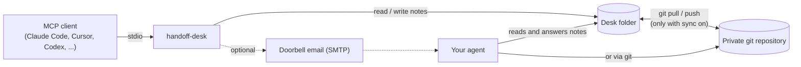

# Architecture

`handoff-desk` is one process, started by your MCP client over stdio. It has no network listener and keeps no state outside the desk folder.

## The desk folder

| Path | Contents |
| --- | --- |
| `handoff.md` | Your rules for the agent: what it may do alone, must ask first, must never do |
| `Desk/` | One note per handoff: `YYYY-MM-DD Item NN - title.md` |
| `Inbox/` | Notes the agent leaves for your client |
| `mail/` | Local copies of doorbell emails |

A note is markdown with a small front matter block (`id`, `type`, `status`, timestamps), a `## Request` section written by `handoff_send`, and a `## Reply` section written by the agent. The full format and the agent's rules are in [cloud-agents.md](cloud-agents.md).

## Status of an item

`waiting` (sent, no answer yet), then `done` (answered), `declined` (the agent will not do it) or `info` (a status line, no answer expected).

## What happens on a send

1. The request is checked for anything that looks like a password, code or key; if so it is refused.
2. A numbered note is written to `Desk/`.
3. With git sync on: the server takes a lock, pulls with rebase, commits only its own note, and pushes (one retry). If the push fails the commit is kept and delivered by the next call. If another sender took the same number, the second one renames its own note.
4. If the doorbell is configured, one email carries the request (TLS or STARTTLS, 45-second cap). A local copy goes to `mail/`.

## What happens on a read or wait

The server pulls (with git sync on), reads the note, and returns the reply. Only regular files named like notes are read; links and folders are skipped. `handoff_wait` repeats this for up to 50 seconds.

## Trust boundaries

- The agent's text is untrusted input to your client: the tool descriptions say so, and replies that look like they hold a secret are refused.
- Git remotes may use only `file`, `https` and `ssh` transports, and credentials inside a URL are removed from error messages.
- Nothing runs on a schedule and nothing is sent anywhere you did not configure. See [SECURITY.md](../SECURITY.md).
